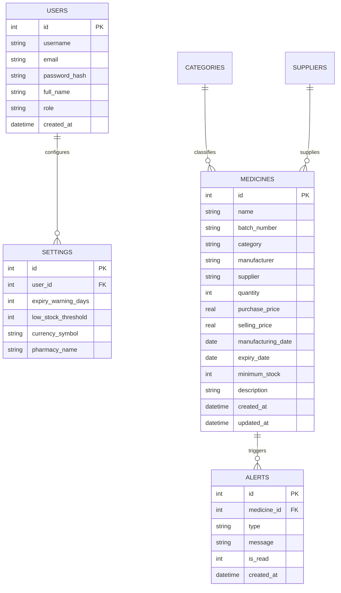
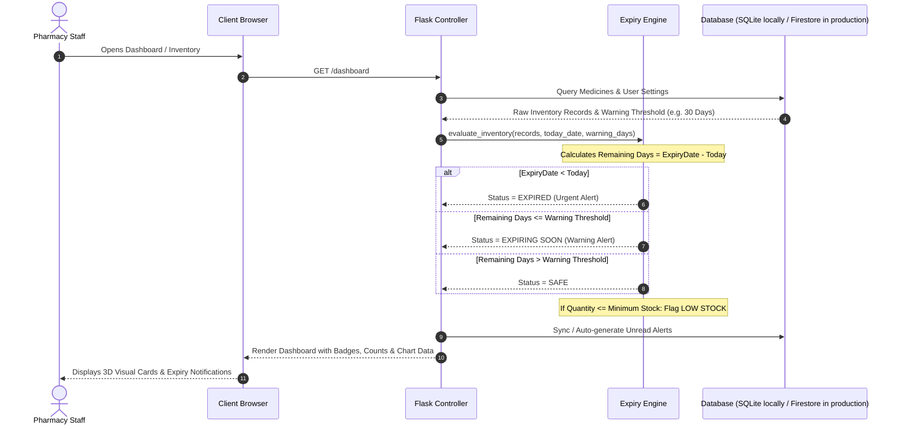

# System Architecture Document
## Medical Expiry Tracker – 3D Modern Medical Inventory & Expiry Management System

---

### 1. Architectural Overview
**Medical Expiry Tracker** utilizes a clean, modular Model-View-Controller (MVC) and RESTful hybrid architecture. The backend is powered by **Python Flask**, with **SQLite** for local development and **Firebase Cloud Firestore** for production persistence. The presentation layer features high-performance semantic HTML5, modern vanilla CSS3 with hardware-accelerated 3D transforms, glassmorphic styling, and vanilla JavaScript (ES6+) driving asynchronous data exchange, dynamic modals, and interactive data visualizations via **Chart.js**.

```mermaid
graph TD
    User([Pharmacy / Clinic User])
    
    subgraph Frontend ["Presentation Layer (HTML5 / Vanilla CSS3 / JS)"]
        UI[3D Glassmorphic Interface & Dashboard]
        Charts[Chart.js Visualizations]
        Toast[Toast & Modal Notification System]
        ClientValidation[Live Form Validator & DOM Renderer]
    end

    subgraph Backend ["Application Layer (Python / Flask)"]
        Router[Flask URL Routing & Middleware]
        AuthMgr[Session & Auth Manager (Werkzeug)]
        ExpiryEngine[Automatic Expiry & Stock Engine]
        ReportGen[Report & CSV/PDF Engine]
        DBService[Database Access Layer]
    end

    subgraph Storage ["Persistence Layer (Firestore production / SQLite local)"]
        DB[(Cloud Firestore / database.db)]
        UsersTable[users collection / table]
        MedicinesTable[medicines collection / table]
        AlertsTable[alerts collection / table]
        SettingsTable[settings collection / table]
        CategoriesTable[categories collection / table]
    end

    User <-->|HTTPS / HTTP| UI
    UI <--> Router
    Router --> AuthMgr
    Router --> ExpiryEngine
    Router --> ReportGen
    AuthMgr --> DBService
    ExpiryEngine --> DBService
    ReportGen --> DBService
    DBService <--> DB
```

---

### 2. Frontend Architecture
The frontend is engineered to be lightweight, ultrafast, and visually stunning without heavyweight frontend frameworks.

- **Design System & Styling**:
  - `static/css/style.css`: Core design tokens (CSS custom properties), glassmorphism classes (`.glass-card`, `.glass-modal`), 3D tilt and floating keyframes, responsive flex/grid layouts, and theme definitions.
- **Client Scripting Modules**:
  - `static/js/app.js`: Global utilities, sidebar toggle for mobile, toast notification dispatcher, confirmation modals, 3D card tilt listeners, and AJAX helpers.
  - `static/js/dashboard.js`: Chart.js configuration and chart rendering (Expiry Status Doughnut, Monthly Expiry Timeline Bar Chart, Category Breakdown Polar/Pie Chart).
  - `static/js/validation.js`: Live input validation enforcing business logic (e.g., expiry date > mfg date, non-negative numbers, required fields).
- **Template Hierarchy (Jinja2)**:
  - `templates/base.html`: Common layout skeleton, responsive navigation drawer, top-bar with notification counter and user profile, and script/style bundles.
  - `templates/login.html`: Dedicated authentication landing with 3D hero visualization and form.
  - `templates/dashboard.html`: Analytics cards, Chart.js canvases, urgent alerts feed, and quick actions.
  - `templates/medicines.html`: Main inventory grid/table with instant search, multi-filter toolbar, and batch actions.
  - `templates/add_medicine.html`: Responsive form for registering new medicine batches.
  - `templates/edit_medicine.html`: Pre-populated edit view.
  - `templates/medicine_details.html`: Detailed inspection modal / view showing batch metadata and shelf life countdown.
  - `templates/alerts.html`: Notification center with batch dismiss and mark-as-read controls.
  - `templates/reports.html`: Multi-criteria reporting studio with CSV export and printable layout.
  - `templates/settings.html`: System configuration (warning threshold, store profile, theme).

---

### 3. Backend Architecture
The backend is organized around Python Flask's application factory and modular route handlers:

- **App Controller (`app.py`)**:
  - **Application Initialization**: Configures Flask app, secret keys, session lifetime, template auto-reloading, and database connections.
  - **Authentication Endpoints**: `/login`, `/register`, `/logout`, `/forgot-password`.
  - **Inventory Endpoints**:
    - `GET /medicines`: Filterable list view.
    - `GET /medicines/add`, `POST /medicines/add`: Creation workflow.
    - `GET /medicines/edit/<id>`, `POST /medicines/edit/<id>`: Update workflow.
    - `POST /medicines/delete/<id>`: Soft/hard delete workflow.
    - `GET /medicines/<id>`: JSON or modal detail endpoint.
  - **Dashboard Endpoints**: `GET /dashboard`, `GET /api/dashboard/stats`, `GET /api/dashboard/charts`.
  - **Alerts Endpoints**: `GET /alerts`, `POST /alerts/mark-read/<id>`, `POST /alerts/delete/<id>`, `POST /alerts/clear-all`.
  - **Reports Endpoints**: `GET /reports`, `GET /reports/export/csv`, `GET /reports/print`.
  - **Settings Endpoints**: `GET /settings`, `POST /settings`.

---

### 4. Database Architecture & Relationships

#### 4.1 Relational Entity Diagram



#### 4.2 Database Collections
- Production stores records in Firestore collections: `users`, `medicines`, `alerts`, `settings`, `categories`, and `suppliers`.
- Local development uses the SQLite schema below in `database.db`; `migrate_to_firebase.py` can copy existing rows into Firestore.
- `users`: Stores user credentials with salted password hashes (`scrypt` or `pbkdf2:sha256`).
- `medicines`: Core inventory ledger with indexed `batch_number`, `expiry_date`, and `category`.
- `alerts`: Generated notification ledger keeping track of read/unread states.
- `settings`: Key-value or tabular configuration defining alert thresholds (default warning window: 30 days).

---

### 5. Automatic Expiry & Stock Calculation Engine



---

### 6. Security Architecture
1. **Password Hashing**: Stored passwords use `werkzeug.security.generate_password_hash` and verified with `check_password_hash`. Plaintext passwords are never logged or stored.
2. **Session Hardening**: Flask session cookies configured with `HttpOnly=True`, `SameSite='Lax'`, and dynamic secret keying.
3. **Database Access**: Production access uses the Firebase Admin SDK on the server; local SQLite queries use parameterized SQL.
4. **Cross-Site Scripting (XSS) Prevention**: All dynamic user strings rendered via Jinja2 auto-escaping.
5. **CSRF Mitigation**: State-changing POST endpoints validate session origins.

---

### 7. Deployment & Execution
- **Local Dev Server**: Built-in Flask WSGI server running on `http://127.0.0.1:5000`.
- **Storage**: Local runs use SQLite; Vercel deployments require Firebase Admin credentials and Cloud Firestore.
