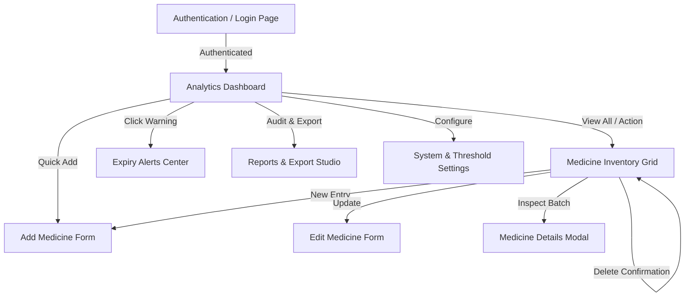
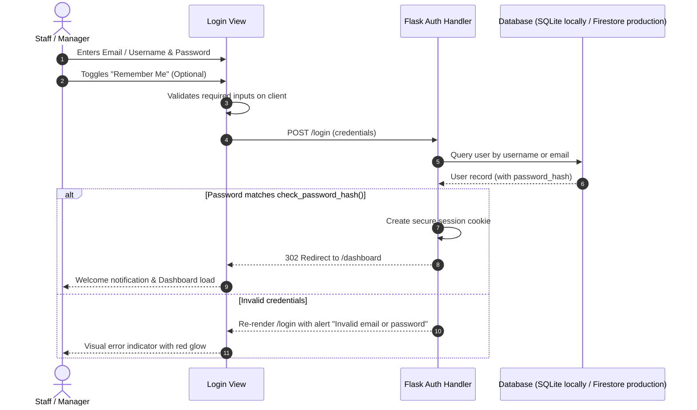
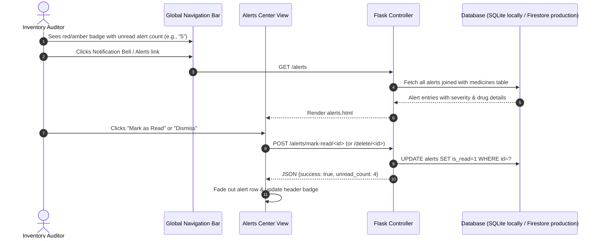
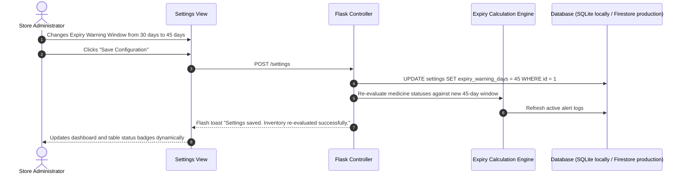

# User Flows & System Interactions
## Medical Expiry Tracker – 3D Modern Medical Inventory & Expiry Management System

---

### 1. High-Level Navigation Architecture



---

### 2. Detailed User & System Flows

#### 2.1 User Authentication & Session Flow


---

#### 2.2 Medicine Creation & Expiry Calculation Flow
```mermaid
sequenceDiagram
    autonumber
    actor User as Pharmacy Staff
    participant UI as Add Medicine View
    participant Valid as Validation Module
    participant Flask as Flask Controller
    participant Engine as Expiry & Stock Engine
    participant DB as Database (SQLite locally / Firestore production)

    User->>UI: Fills Medicine Details (Name, Batch, Dates, Qty, Prices)
    User->>UI: Clicks "Save Medicine"
    UI->>Valid: validateDates(mfgDate, expDate)
    alt ExpiryDate < MfgDate
        Valid-->>UI: Block submit; show "Expiry date must be after manufacturing date"
    else Inputs Valid
        UI->>Flask: POST /medicines/add (Form Data)
        Flask->>Engine: calculate_status(expiry_date, quantity, minimum_stock)
        Engine-->>Flask: Status (SAFE / EXPIRING SOON / EXPIRED) + Days Remaining
        Flask->>DB: INSERT INTO medicines (...)
        alt Status in (EXPIRING SOON, EXPIRED, LOW STOCK)
            Flask->>DB: INSERT INTO alerts (medicine_id, type, message)
        end
        Flask-->>UI: 302 Redirect to /medicines with flash toast
        UI-->>User: "Medicine saved successfully!" Toast notification
    end
```

---

#### 2.3 Expiry Alert & Notification Processing Flow


---

#### 2.4 Search, Multi-Filter & Real-Time Sort Flow
```mermaid
sequenceDiagram
    autonumber
    actor User as Store Clerk
    participant UI as Medicines Inventory Page
    participant JS as Client Search Controller
    participant Table as Inventory DOM Table

    User->>UI: Types "Amox" in Instant Search Bar
    UI->>JS: oninput trigger (debounced 150ms)
    JS->>Table: Filter rows matching Name or Batch Number
    User->>UI: Selects Filter: Category = "Antibiotic", Status = "Expiring Soon"
    UI->>JS: applyFilters({search: "Amox", category: "Antibiotic", status: "EXPIRING_SOON"})
    JS->>Table: Dynamically show matching rows; hide non-matching
    alt Matching records found
        JS->>Table: Update visible counter (e.g. "Showing 2 of 24 medicines")
    else Zero matches
        JS->>Table: Render beautiful empty state ("No medicines match your filter criteria")
    end
```

---

#### 2.5 Report Generation & Export Flow (CSV / Print PDF)
```mermaid
sequenceDiagram
    autonumber
    actor User as Pharmacy Owner
    participant ReportUI as Reports Studio View
    participant Flask as Flask Controller
    participant Exporter as CSV / Print Engine
    participant DB as Database (SQLite locally / Firestore production)

    User->>ReportUI: Selects Report Type ("Expiring Soon", "Expired Batches", "Low Stock")
    alt Clicks "Export CSV"
        ReportUI->>Flask: GET /reports/export/csv?type=expiring_soon
        Flask->>DB: Query filtered inventory records
        Flask->>Exporter: Generate RFC-4180 CSV string with UTF-8 BOM
        Exporter-->>ReportUI: Content-Disposition: attachment; filename="medicines_expiring_soon.csv"
        ReportUI-->>User: Browser automatically downloads clean CSV spreadsheet
    else Clicks "Print / PDF"
        ReportUI->>ReportUI: Apply `@media print` CSS stylesheet
        ReportUI->>User: Opens browser native Print / Save as PDF dialogue with clean header
    end
```

---

#### 2.6 System Settings & Threshold Update Flow

